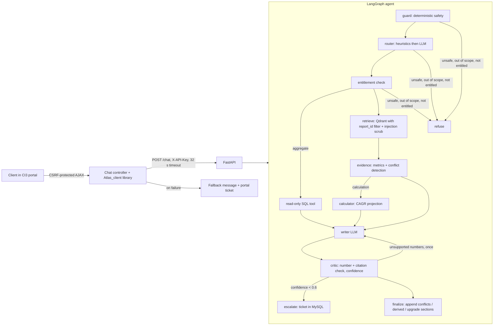

# Project Atlas - Report Copilot

A Report Copilot for Cognitive Market Research. It answers client questions about market reports inside the
existing CodeIgniter 3 portal. Every number is cited, derived figures are labelled with their formula, conflicting
sources are shown side by side, unpurchased content never reaches the LLM, and low-confidence answers are handed to
a human analyst.

```
CI3 portal (PHP)  --HTTP + API key-->  FastAPI + LangGraph agent (Python)  -->  Groq (Llama 3.3 70B / 3.1 8B)
      |                                   |            |
      +--> MySQL (conversations,          |            +--> Qdrant (chunks + metadata, entitlement filter)
           feedback, fallback tickets)    +--> MySQL (catalogue, metrics, purchases, tickets, logs)
```

## Quick start (about 5 minutes)

Prerequisites: Docker with the Compose plugin, and a free Groq API key from https://console.groq.com/keys.

```bash
git clone <repo> atlas && cd atlas
cp .env.example .env          # then set GROQ_API_KEY and ATLAS_API_KEY in .env
docker compose up --build -d  # first build is about 3-4 minutes (Python deps + embedding model baked in)
docker compose ps             # wait until api is "healthy"
```

| What | URL |
|---|---|
| Chat page (CodeIgniter 3) | http://localhost:8080 (pick C-01 Northwind or C-02 Blue Delta) |
| API docs (Swagger) | http://localhost:8000/docs |
| Health | http://localhost:8000/health |

On first start the API ingests `data/reports/*.md` into Qdrant automatically. Try the API directly:

```bash
KEY=$(grep ^ATLAS_API_KEY .env | cut -d= -f2)
curl -s localhost:8000/chat -H "X-API-Key: $KEY" -H "Content-Type: application/json" \
  -d '{"client_id":"C-01","question":"What was the global smart water meter market size in 2024?"}' | python -m json.tool
curl -s localhost:8000/escalations -H "X-API-Key: $KEY"
curl -s localhost:8000/security-events -H "X-API-Key: $KEY"     # injection / unsafe-request log
curl -s -X POST localhost:8000/ingest -H "X-API-Key: $KEY" -H "Content-Type: application/json" -d '{}'
```

Tests and evaluation:

```bash
docker compose exec api pytest -q                              # 53 unit tests, no services needed
docker compose exec -u root api python eval/run_eval.py         # 30-question eval against the live API
# -> api/eval/results/report.md and results.json
```

Reset everything (including the database): `docker compose down -v`.

## Architecture



Answer flow for a normal question:

1. **guard.** Deterministic regexes catch injection in the question, data-modification requests, personal data,
   other clients' purchases, politics and explicit escalation requests. The unsafe ones are logged to
   `security_events`. No LLM is involved, so it cannot be talked out of a refusal.
2. **router.** Heuristics classify the question into factual, comparison, calculation or aggregate. Only
   unmatched questions go to Llama 3.1 8B, which returns JSON.
3. **entitlement.** Computes the client's entitled set (purchased reports plus public excerpts). If the question
   names a report the client hasn't bought, or a market none of its reports cover, it refuses and names the report
   with an upgrade path. No figures from that report are shown.
4. **retrieve.** Runs a Qdrant search with a `report_id IN entitled` payload filter, so locked text never leaves
   the vector DB. Each chunk is scanned for injection, and offending paragraphs are removed (the rest of the page,
   including the real figures, is kept) and logged. Hybrid-lite re-rank: 0.8 × dense + 0.2 × keyword overlap.
   There is a relevance floor of 0.58.
5. **evidence.** Pulls structured figures from `market_metrics` for entitled reports only. Conflicts are detected
   in code: same market, metric, region and year with a different value, or a different CAGR window.
6. **calculator.** Projects V × share × (1 + CAGR)^n per source report and never blends reports. It shows the
   formula, the inputs with citations, every assumption, and the base-year ambiguity with the alternative value.
   It refuses to extrapolate past a report's forecast window and escalates instead.
7. **writer.** Llama 3.3 70B gets only the entitled material, with retrieved text wrapped in `<source>` tags that
   are declared to be data. It must tag every number (`[F1]`, `[C2]`, `[D1]`, `[Q1]`).
8. **critic.** Every number in the draft must match a number the writer was shown. An unsupported number (for
   example an average) triggers one rewrite, then escalation. A tripwire flags numbers that match figures from
   unpurchased reports. Invalid citation tags are penalised. Confidence comes from transparent rules with
   human-readable reasons.
9. **finalize or escalate.** Finalize appends the conflicts, derived-estimate and upgrade sections from structured
   data, so they are always exact. Below 0.6 confidence, the agent opens a ticket in `escalations` (the draft is
   kept for the analyst, not shown to the client) and tells the client an analyst will reply.

## How each hard part is handled

| Challenge | Implementation | Where |
|---|---|---|
| Conflicting sources | Detected in code from `market_metrics`, rendered side by side with scope notes. The critic rejects any number not in the sources, so an average (4.04) cannot get through. | `tools/conflicts.py`, `agent/critic.py` |
| Missing numbers | Calculator projects per report with formula, inputs, assumptions and base-year ambiguity (2024 base vs 2025-2030 window gives 3.02 vs 2.72). Labelled `derived_estimate`. R-102 is not stretched past 2029, and 2035 escalates. | `tools/calculator.py` |
| Prompt injection | Detection plus paragraph removal before the LLM, `<source>` isolation in the prompt, logging to `security_events` (at ingest and per request). The real figures on R-102 p.14 are still used. | `security/injection.py` |
| Entitlements | Qdrant payload filter, entitled-only metric queries, locked reports named without figures plus an upgrade hint, a leak tripwire in the critic, and a cache key that includes the entitlement set. | `agent/graph.py` (entitlement, retrieve), `cache.py` |
| SQL safety | The LLM writes SQL, then a validator (sqlglot) allows a single SELECT on `reports` only, blocks comments and dangerous keywords, and forces a LIMIT. Inside MySQL, the `atlas_ro` user can SELECT on `reports` only, with `MAX_EXECUTION_TIME` and a READ ONLY transaction. The app user cannot read `clients.contact_email` (column-level grant). | `security/sql_guard.py`, `db/init/03_users.sh` |
| Out of scope and sensitive | Deterministic guard gives a polite refusal with a reason. Unclassifiable questions with no library match are refused. | `security/guard.py`, `agent/render.py` |
| Latency and cost | Per-request token cap (6,000), a deadline-aware LLM timeout, an 8B model for routing, many paths with no LLM call at all, a TTL cache, and cost per request in `request_log` and the response. | `llm.py`, `cache.py`, `service.py` |
| Evaluation | 30 questions with machine-checkable expectations, scored against the live API. | `api/eval/` and [EVALUATION.md](EVALUATION.md) |

## API

All endpoints except `/health` need the `X-API-Key` header.

| Endpoint | Purpose |
|---|---|
| `POST /chat` | `{client_id, question, history?}` returns `{answer, citations[], confidence, confidence_reasons[], conflicts[], derived_values[], escalated, escalation_id, locked_reports[], sql_query, injection_detected, cached, latency_ms, tokens, cost_usd}` |
| `POST /ingest` | Rebuilds the vector collection from `data/reports` and clears the cache |
| `GET /escalations?status=open` | Analyst ticket queue |
| `GET /security-events` | Injection and unsafe-request log (extra) |
| `GET /health` | MySQL, Qdrant, vector count, LLM configured |

Requests are validated with Pydantic (`extra=forbid`, a client-id pattern, length limits). `/chat` has a 28-second
server timeout and returns a 504 with a clear message. Unknown clients get a 404. Unhandled errors return a generic
500 and are logged.

## CodeIgniter 3 integration

- `Chat` controller, `Atlas_client` library (cURL with connect and total timeouts, never throws),
  `Conversation_model`, and views in `portal/application/`. The CI3 framework itself is downloaded from the
  official 3.1.13 release at build time.
- **Security.** CSRF protection on every POST, including the AJAX ask and feedback calls. Every value is escaped
  with `html_escape()` in views, and the JS inserts all server text with `textContent`, never `innerHTML`. JSON is
  encoded with `JSON_HEX_*`. A strict Content-Security-Policy is set (no inline script). Session cookies are
  HttpOnly and SameSite, and the session id is regenerated at sign-in. The client id sent to the API comes from
  the server-side session, never from the browser. Logout is POST-only. The application folder sits outside the
  web root.
- **Fallback.** On a timeout, connection error, non-200 response or malformed JSON, the client sees a clear
  message. The question is saved and a ticket is created directly in MySQL, so it still reaches an analyst.
- Conversations and thumbs-up/down feedback are stored in `conversations` and `feedback`. The feedback endpoint
  checks that the conversation belongs to the signed-in client.
- The sign-in page is a demo stand-in for the portal's existing login.

## Data

Six synthetic reports are in `data/reports/*.md`, as Markdown with `<!-- page: N -->` markers. R-101 to R-103 and
their metrics are exactly as in Appendix A. The trap sentence is on R-101 p.8 and the injection footnote on
R-102 p.14. R-104 to R-106 were added for other sectors. Clients C-01 and C-02 match the appendix, and C-03 was
added. `clients.purchased_reports` is normalised into `client_purchases`. R-102 (`public excerpt`) is visible to
every client, which is why C-01 sees both R-101 and R-102 in the appendix's question 1.

## Design decisions and trade-offs

- **Deterministic where correctness matters, LLM where language matters.** Entitlements, conflicts, the maths,
  refusals and the "every number is sourced" check are code and unit-tested. The LLM only phrases answers and
  routes the questions the heuristics miss. This is the main reason the traps hold. The trade-off is a little
  less flexible phrasing.
- **Structured metrics plus RAG.** The figures live in `market_metrics` with page numbers, which gives exact
  citations and lets conflict detection run without asking the LLM. Excerpts from RAG add context and explain
  scope. If the figures were only in PDFs, the next step would be an extraction pass into this table.
- **Escalate rather than guess.** A 1-year extrapolation for R-102 to 2030 is not shown when R-101 covers 2030.
  If no report covers the target year, the agent escalates.
- **Local embeddings (fastembed, bge-small, ONNX).** No API key or per-token cost, and the model is baked into
  the image so startup is offline. bge-small is weaker than large hosted models, which the relevance floor and
  the structured figures make up for.
- **Groq.** Fast inference that fits the 30-second target. The free tier is rate-limited, so the client falls back
  from the 70B model to the 8B model, and then to a template answer built from structured data if both fail.
- **In-process cache.** Simple and correct (the key includes the entitlement set), but not shared across API
  replicas. Redis would be the next step.

## What I cut, and why

- **PDF and HTML ingestion.** The corpus is Markdown with page markers, which keeps page citations exact. A PDF
  loader (pypdf, page by page) would plug into `rag/ingest.py`.
- **Langfuse/LangSmith.** Replaced by structured JSON logs (per-node timings, every LLM call with tokens and
  cost) plus `request_log` and `security_events` tables. This means no extra service for the reviewer to run.
- **Streaming responses, semantic cache, cross-encoder re-ranker.** These are bonuses. The re-rank is a light
  hybrid (dense plus lexical).
- **Real authentication in the portal.** It uses a demo client picker because the brief assumes an existing
  portal login.
- **Multi-turn memory.** Only the last 3 questions are sent, and they are used to resolve the topic.

## Repository layout

```
api/                 FastAPI service (app/), unit tests (tests/), evaluation (eval/)
  app/agent/         LangGraph graph, routing, critic, prompts, deterministic renderers
  app/security/      input guard, injection scrubber, SQL validator
  app/tools/         calculator, conflict detector, SQL tool
  app/rag/           embeddings, Qdrant store, ingestion
portal/              CodeIgniter 3 application overrides + Dockerfile
db/init/             schema, seed, least-privilege users
data/reports/        6 synthetic reports
```

## AI-assistant disclosure

I used Claude Code (Anthropic) as a pair programmer for scaffolding, first drafts of most modules, the synthetic
report text (R-104 to R-106 and the expansion of R-101 and R-102), tests and documentation. I designed the
architecture and guardrail strategy, reviewed and edited every file, and ran the unit tests and end-to-end smoke
tests. The smoke tests found real bugs that I fixed, for example LangGraph node names clashing with state keys and
a missing relevance floor. I can explain every line.
